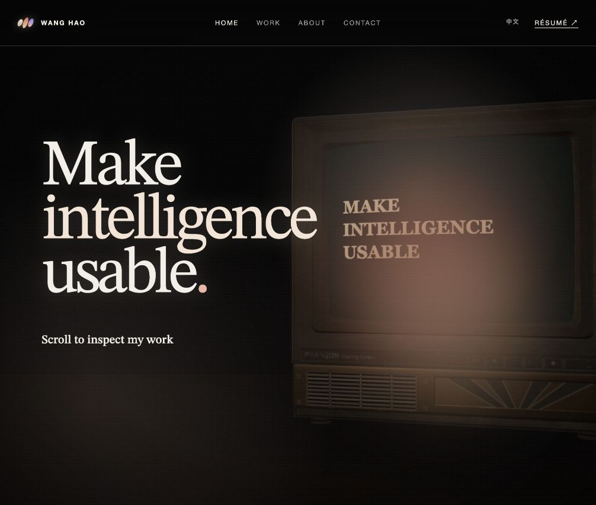

# Wang Hao

王昊的个人主页。页面借鉴 Shader Development Studio 的滚动叙事：固定黑色舞台、巨型衬线 Hero、开源项目轮播、About 和 Contact 区域。

[访问网站](https://redheartsecretman.top/) · [GitHub](https://github.com/RedHeartSecretMan)



## 交互

- 顶部导航在滚动过程中保持可见，并高亮当前 section。
- Work 支持拖拽、触摸滑动、触控板横向滚动和键盘左右方向键切换项目。
- Work 精选 `vllm-oxide`、`dag-skill`、`a-share-research-skill` 和 `any-translate`，每个项目可直接进入对应的 GitHub 仓库。
- CRT 模型响应指针和滚动；内屏使用原模型的玻璃曲面材质显示双语文字，遵守 `prefers-reduced-motion`。
- Three.js 舞台使用电影感色调映射、屏幕暖光、紫橙氛围雾和地面阴影，光影随用户指针与滚动变化。
- 窄屏时首屏中文标题与 CRT 模型会按视口重新排布，避免电视被裁切。
- 所有 Résumé 入口指向 <https://me.redheartsecretman.top/>。

## 本地预览

这是一个无需构建工具的静态页面：

```bash
python3 -m http.server 4173
```

然后打开 <http://localhost:4173/>。

源站观察记录见 [`docs/research/shader.md`](docs/research/shader.md)。

## 验证

```bash
node --test tests/*.test.mjs
node --check redirect.js
```

内屏回归检查使用真实 glTF 数据，验证曲面顶点未变、UV 方向正确、外壳遮挡有效。
